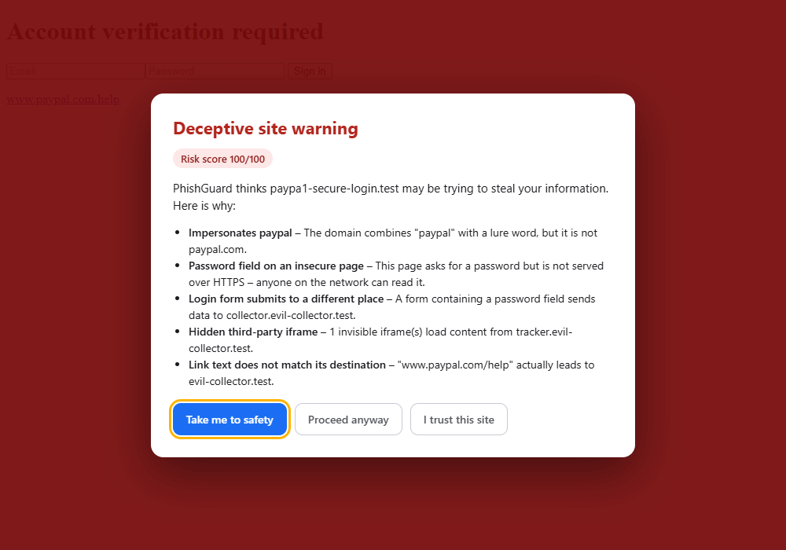
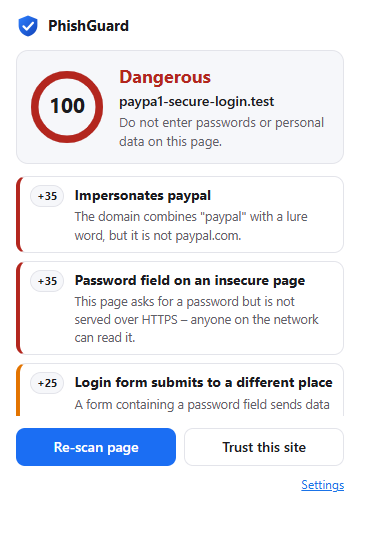
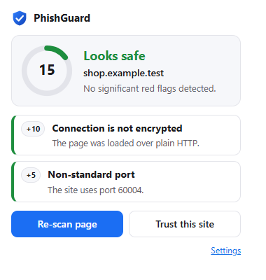
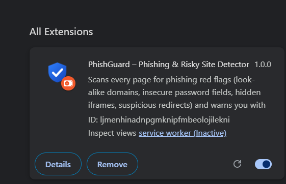
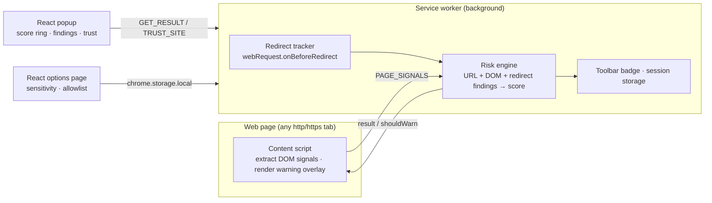

# 🛡️ PhishGuard – Phishing & Risky-Site Detector

[](https://github.com/<your-username>/phishguard/actions/workflows/ci.yml)


PhishGuard is a Chrome extension (Manifest V3, React + JavaScript) that inspects every page you visit for
phishing red flags **entirely on your device**, shows a 0–100 risk score on the toolbar badge, and puts a
full-page warning in front of dangerous sites.

| Warning screen | Popup – dangerous | Popup – safe | Chrome Extension |
|---|---|---|---|
|  |  |  |  |

## What it detects

| Signal | Example | Points |
|---|---|---|
| **Look-alike / typosquatted brand domain** | `paypa1.com`, `paypel.com`, `g00gle.com` | 55 |
| Brand in a sub-domain of another site | `paypal.com.account-check.xyz` | 55 |
| Brand + lure word | `paypal-secure-login.com` | 45 |
| Navigation *started* at a look-alike address and was forwarded | `walamrt.com` → real site | 20 |
| **Password field on a non-HTTPS page** | login form served over `http://` | 35 |
| Credentials embedded in the URL | `https://google.com@evil.example` | 30 |
| **Hidden third-party iframes** (0×0, `display:none`, off-screen) | invisible tracker / credential-harvesting frame | 20–30 |
| Login form that posts to another domain / to `http://` | `<form action="https://collector.evil/…">` | 25 |
| Raw IP address host · punycode (IDN homograph) | `http://203.0.113.7/login`, `xn--pple-43d.com` | 25 |
| Link text that names one site but points to another | `www.paypal.com` → `evil.test` | 15–25 |
| **Suspicious redirects** | bounced across 3+ domains, or 4+ hops | 10–20 |
| Meta-refresh to another site · high-abuse TLD · deep sub-domains · odd ports · long host/path | | 5–15 |

Scores add up (capped at 100). Default thresholds: **≥ 25 suspicious**, **≥ 55 dangerous** (overlay is shown).
Strict / Balanced / Relaxed presets are available in the settings page.

## Architecture



**Design decisions**

- **Pure core, thin shells.** All detection logic lives in `src/shared/` as dependency-free pure functions
  (`analyzeUrl`, `evaluateDomSignals`, `evaluateRedirects`, `buildResult`). The content script only converts the DOM into
  plain data (`content/extract.js`), so the heuristics are unit-testable without a browser.
- **Stateless service worker.** MV3 workers are killed when idle, so per-tab results, redirect chains and DOM snapshots
  are kept in `chrome.storage.session`, never in module-level variables.
- **Content script isolation.** The warning UI is rendered in a Shadow DOM with `all: initial` so page CSS cannot restyle it;
  only the top frame is trusted for scoring (`sender.frameId === 0`).
- **SPA-aware.** A bounded, debounced `MutationObserver` re-scans pages when login forms or iframes are injected late.
- **Privacy by design.** No remote calls, no analytics, no browsing history leaves the browser. Settings stay in
  `chrome.storage.local`.
- **Least privilege.** Permissions: `storage`, `tabs`, `webNavigation`, `webRequest` (observe-only, to see redirect hops) and
  http/https host access for the content script.

## Getting started

```bash
git clone https://github.com/<your-username>/phishguard.git
cd phishguard
npm install
npm run build          # bundles everything into ./dist
```

1. Open `chrome://extensions` and enable **Developer mode**.
2. Click **Load unpacked** and choose the `dist/` folder.
3. Visit any site – the badge shows the risk score. Click the icon for the details.

`npm run dev` rebuilds on every change (reload the extension after each build).

### Try it safely

The e2e fixtures contain a harmless fake phishing page. To see the warning screen without visiting anything dangerous,
run `npm run test:e2e` and open `docs/screenshots/`, or serve `e2e/fixtures/phish.html` and map a look-alike
hostname to `127.0.0.1` in your hosts file.

## Testing

```bash
npm test               # 29 unit tests (Node's built-in test runner – no extra dependencies)
npx playwright install chromium
npm run test:e2e       # builds, loads the extension in real Chromium and drives it end-to-end
```

- **Unit tests** cover URL analysis (legitimate sites must produce zero findings), DOM-signal heuristics, redirect
  logic, scoring/thresholds, allowlist and domain helpers.
- **End-to-end tests** load the built extension with Playwright, serve fake phishing and benign pages on `*.test`
  hostnames and assert: overlay shown/dismissed, toolbar badge, popup findings, trust-this-site flow, redirect-chain
  detection and settings persistence. The same suite runs on every push via GitHub Actions
  (`.github/workflows/ci.yml`).

## Project structure

```
public/              manifest.json, popup.html, options.html, icons
src/
  shared/            pure detection logic + settings   (unit-tested)
    urlAnalysis.js     look-alike domains, IP/punycode/userinfo, TLD, ports …
    domSignals.js      password/http, forms, hidden iframes, link mismatch, meta refresh
    redirects.js       redirect-chain heuristics
    engine.js          merges findings → score → level
  content/           DOM extraction, warning overlay, rescans
  background/        service worker, redirect tracking, badge
  popup/             React popup
  options/           React settings page
tests/               node:test unit tests
e2e/                 Playwright end-to-end test + fixture pages
build.mjs            esbuild bundler (IIFE bundles for MV3)
```


## License

MIT © Monica Purushothaman
